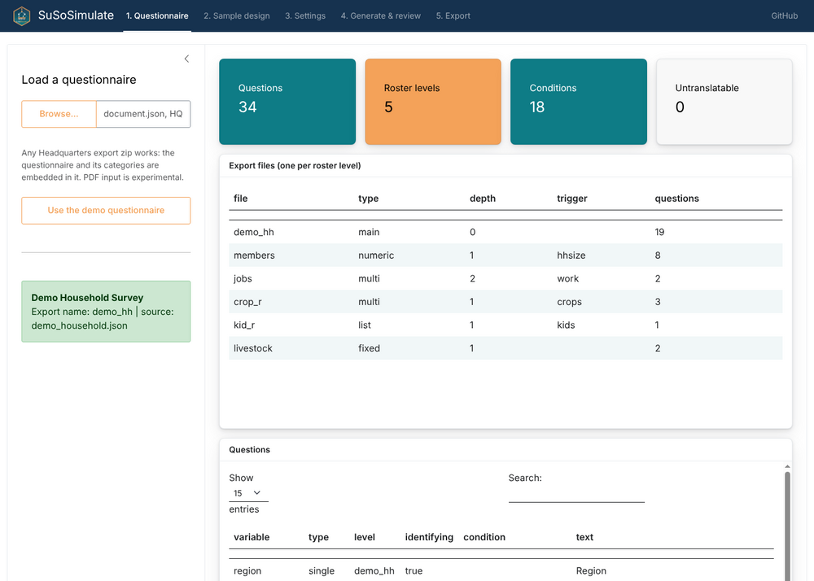
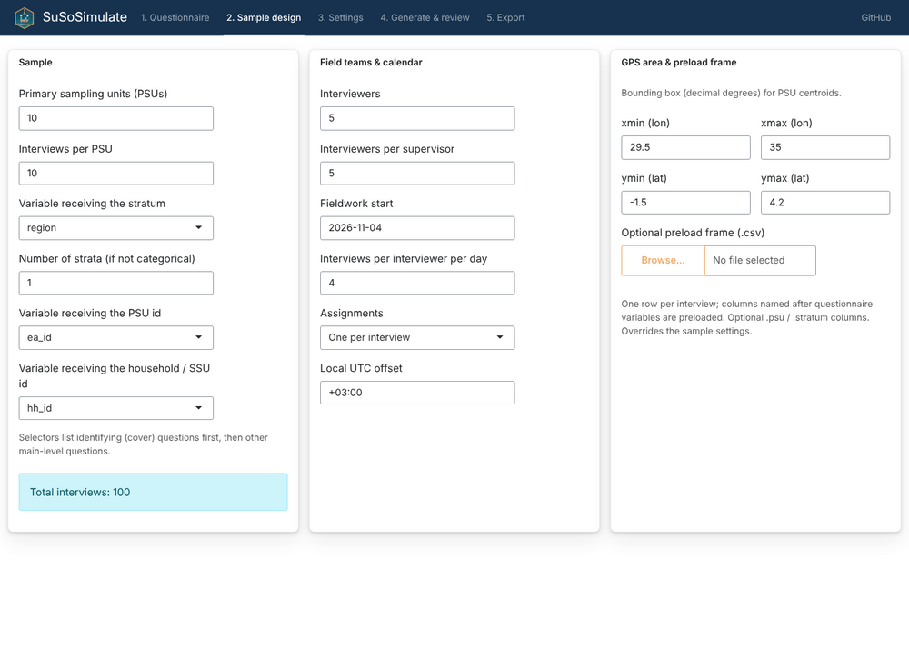
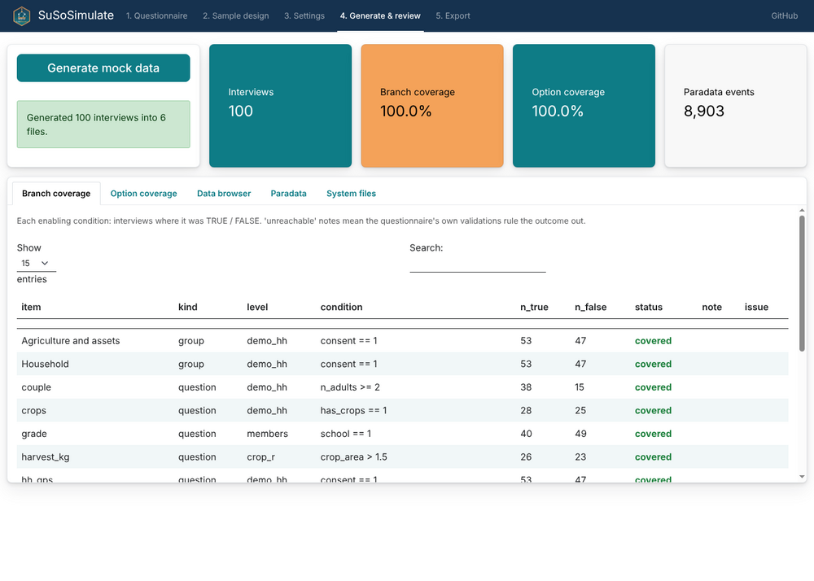
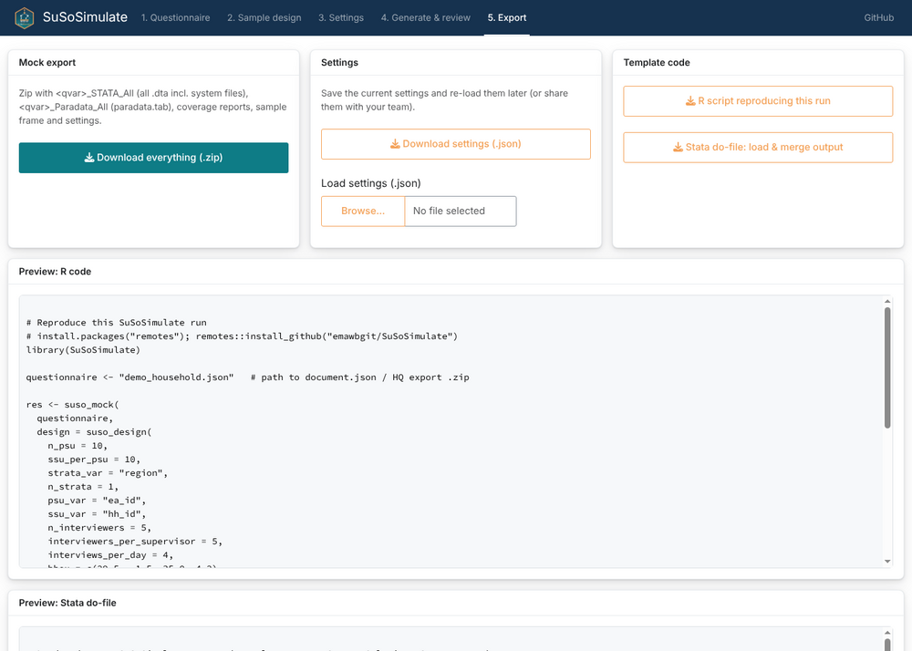

# SuSoSimulate 

**Mock data and paradata generator for Survey Solutions questionnaires.**

SuSoSimulate reads a [Survey Solutions](https://mysurvey.solutions) (SuSo) questionnaire, runs its skip logic, and produces synthetic interviews that are fully routed and pass validation. The output is a Stata or Tabular export with the same multi-file layout as a real Headquarters download: a main file, one file per roster level, the system files and the paradata.

With it you can:

- Build and debug cleaning do-files, HFC dashboards and analysis pipelines before fieldwork starts.
- Check that every enabling-condition branch can be reached, using a coverage report. You don't need human pre-testers to click through every path.
- Standardise test data across a research unit, reproducibly from a seed.

---

## Contents

1. [Features](#features)
2. [Installation](#installation)
3. [Testing the package locally](#testing-the-package-locally)
4. [Shiny app](#shiny-app)
5. [Quick start](#quick-start)
6. [Inputs](#inputs)
7. [Configuration reference](#configuration-reference)
8. [Output](#output)
9. [How it works](#how-it-works)
10. [Supported C# expression syntax](#supported-c-expression-syntax)
11. [Export conventions](#export-conventions)
12. [Paradata and system files](#paradata-and-system-files)
13. [Working with the output in Stata](#working-with-the-output-in-stata)
14. [Localised questionnaires and special characters](#localised-questionnaires-and-special-characters)
15. [Validation against a real export](#validation-against-a-real-export)
16. [Limitations](#limitations)
17. [Troubleshooting](#troubleshooting)
18. [Package structure](#package-structure)
19. [Reporting bugs](#reporting-bugs)
20. [Citation](#citation)
21. [Authors](#authors)
22. [License](#license)

---

## Features

| Area | What it does |
|---|---|
| **Input** | Any HQ export zip (Stata, Tabular, ...: the questionnaire, categories and attachments are embedded under `Questionnaire/content.zip`); `content.zip` itself; a Designer zip; `document.json`; an unpacked folder. In R only, experimentally, the PDF printout |
| **Question types** | Numeric (integer/decimal, special values), single-select (incl. cascading, combo box, filtered, linked), multi-select (plain, ordered, yes/no, linked), text, masked text, text list, date, timestamp, GPS, barcode, picture, audio, area, calculated variables, static text |
| **Rosters** | Numeric-, multi-select-, yes/no-, list-triggered and fixed rosters, nested to any depth; rosters sharing a trigger are merged into one level exactly as SuSo does |
| **Logic** | Translates C# enabling conditions, validations, option filters, linked filters, macros, lookup tables and calculated variables into R, with C# null semantics |
| **Coverage** | Generators deliberately steer toward branch constants; a repair loop swaps redundant interviews for ones that hit missing branch outcomes; a report flags anything uncovered or provably unreachable |
| **Sampling** | Strata → PSUs → secondary units, preload of identifying questions, interviewer/supervisor teams (logins taken from the questionnaire's enumerator question), fieldwork calendar, PSU GPS centroids inside a survey boundary drawn on OpenStreetMap or loaded from GeoJSON, or a user-supplied frame |
| **Output** | HQ **Stata** export (`.dta`, `.a` for unanswered) or **Tabular** export (`.tab` + `.do`, `-999999999` / `##N/A##`), with SuSo naming, ordering, labels and missing-value codes; `paradata.tab`; `interview__actions`, `__diagnostics`, `__errors`, `__comments`, `assignment__actions`; the assignments (preload) file; coverage reports; a JSON record of all settings |
| **Consistency** | `suso_validate_mock()` cross-checks ids, statuses, error and comment counts, assignments, interviewers and paradata across all files |
| **Languages** | French, Spanish and other localised questionnaires: accents, cedillas, `¿ ¡`, curly quotes and non-Latin scripts pass through unchanged; Latin-1 / Windows-1252 inputs are converted; text answers follow the questionnaire's language; works in UTF-8 and C locales |
| **Interfaces** | Shiny app (point-and-click, iehfc-style workflow), interactive console wizard, and a scriptable API; progress with estimated time remaining |

---

## Installation

### Requirements

- **R ≥ 4.1** on Windows, macOS or Linux. The package is pure R, so no compiler or Rtools is needed.
- **Required packages:** `jsonlite`, `haven`, `zip` (installed automatically with the package).
- **Optional packages:**
  - `readxl` — reusable categories stored as `.xlsx` (standard in Designer/HQ archives).
  - `pdftools` — PDF input.
  - `shiny` (≥ 1.7), `bslib` (≥ 0.6), `DT` — the Shiny app.
  - `testthat` — running the test suite.

### Option A — install from GitHub (recommended)

```r
install.packages(c("remotes", "readxl", "pdftools", "shiny", "bslib", "DT", "testthat"))
remotes::install_github("emawbgit/SuSoSimulate")
```

### Option B — install from a local clone

```bash
git clone https://github.com/emawbgit/SuSoSimulate.git
cd SuSoSimulate
R CMD INSTALL .
```

Or, from inside R with the working directory set to the clone:

```r
install.packages(c("jsonlite", "haven", "zip", "readxl", "pdftools", "shiny", "bslib", "DT", "testthat"))
install.packages(".", repos = NULL, type = "source")
```

### Option C — install from a source tarball

```r
install.packages("SuSoSimulate_0.6.0.tar.gz", repos = NULL, type = "source")
```

### Check the installation

```r
library(SuSoSimulate)
demo <- system.file("extdata", "demo_household.json", package = "SuSoSimulate")
qn <- suso_read_questionnaire(demo)
qn
#> <suso_questionnaire> Demo Household Survey (demo_hh)
#>   Sections: 3 | Questions: 34 | Variables: 1 | Rosters: 5 | Levels: 5
```

---

## Testing the package locally

The package ships with a demo questionnaire, `inst/extdata/demo_household.json`. It covers numeric, multi-select, list- and fixed-triggered rosters, a nested roster, cascading and linked questions, yes/no, GPS, masks, macros, `@rowcode` and LINQ conditions.

### 1. Run the automated test suite

From a clone of the repository:

```r
# install.packages("testthat")
testthat::test_local()          # runs tests/testthat against the source tree
```

Or from the command line, inside the clone:

```bash
Rscript -e 'testthat::test_local()'
```

Expected result: `[ FAIL 0 | WARN 0 | SKIP 1 | PASS 306 ]` (the skipped test runs only in a non-UTF-8 locale). The suite has eleven files:

| File | What it checks |
|---|---|
| `test-expressions.R` | C# null semantics, integer division and modulo; `InRange`, `InList`, ternaries, macros; roster LINQ; multi-select `Contains`/`Length`; parsing of comments, generics, casts and `??` |
| `test-generation.R` | End to end on the demo: file set, id columns, system variables, routing invariants, 100% branch coverage, seed reproducibility, a scripted run of the console wizard |
| `test-edge-cases.R` | A hostile fixture questionnaire (`tests/testthat/fixtures/edge_cases.json`), checked for referential integrity and routing semantics across all files (see below) |
| `test-validation.R` | Clear errors for invalid arguments and malformed files; safe helpers; factor columns in frames; paradata encoding (UTF-8 BOM, CRLF); zip output |
| `test-app.R` | The Shiny server workflow (load → generate → download zip / settings → re-upload settings → bad file), and a run of the R script the app writes |
| `test-export-layout.R` | Export folder `<Q>_<version>_SuSoMock_STATA` (`_2` when it exists), versioned zip names and zip-root contents, `export__info.json`, re-reading the exported STATA zip (version detection), paradata event order and roles (`suso_read_paradata()`) |
| `test-formats-consistency.R` | Tabular export (`.tab`/`.do`, BOM/CRLF, `-999999999` vs Stata `.a`), `suso_validate_mock()` on both assignment modes and on a corrupted result, interviewer question and cover-first order, GeoJSON boundary, geography (area) measures, `new decimal?[]{...}` and `Quest.IRnd()` |
| `test-localization.R` | A French/Spanish fixture (`fixtures/localized`: accents, `« »`, `¿ ¡`, `ñ ß ø Ł`, CJK, reusable categories in TSV) exported to Stata and Tabular into an accented folder; Latin-1 frame, category file and generator output; failing generators; `options(OutDec = ",")`; accented upload names in the app. Passes in UTF-8 and C locales |
| `test-lookup.R` | Lookup tables (`table[rowcode].col`, `ContainsKey`, LINQ over a table) and their re-export in `content.zip`; HQ 26.x `$type` dictionaries; comma-list macros; multi-select combo boxes; id domains from option filters; constant switches flagged unreachable; 26.07 label conventions |
| `test-pdf.R` | PDF reader on a synthetic printout (integer types, wrapped options, conditions and validations); `ConsistsOf`; code-like text answers |
| `helper-integrity.R` | Shared checker: unique keys, every roster row has a parent row, no orphan interviews, sequential paradata order, parseable timestamps |

The edge-case fixture covers:

- DateTime arithmetic and `DateTime.Today`.
- `??`, string methods, a SelectMany variable.
- A yes/no-triggered roster, a fixed roster with per-row conditions, three nesting levels.
- Rosters sharing a trigger, an option filter, a linked multi-select pointing into another roster.
- Circular conditions, a lookup table, broken syntax.
- Missing reusable categories, numeric special values, over-long variable names, and every media question type.

### 2. Run the full package check

```bash
R CMD build .
R CMD check --no-manual SuSoSimulate_0.6.0.tar.gz
```

Expected: `Status: OK`.

### 3. Generate the demo dataset and inspect it

```r
library(SuSoSimulate)
demo <- system.file("extdata", "demo_household.json", package = "SuSoSimulate")

res <- suso_mock(
  demo,
  design = suso_design(n_psu = 4, ssu_per_psu = 6,
                       strata_var = "region", psu_var = "ea_id", ssu_var = "hh_id"),
  out_dir = "mock_demo", seed = 42)   # -> mock_demo/demo_hh_1_SuSoMock_STATA/

res                           # summary + coverage + export folder
res$export_dir
names(res$data)               # "demo_hh" "members" "jobs" "crop_r" "kid_r" "livestock"
head(res$data$members)
res$coverage$branches         # TRUE/FALSE counts for each of the 18 conditions
```

### 4. Verify the routing yourself

```r
m   <- res$data$demo_hh
mem <- res$data$members
jb  <- res$data$jobs

stopifnot(
  all((m$consent == 2) == (m$refusal_reason != "")),                 # refusal text only if refused
  all(((mem$age >= 5) & (mem$age <= 24)) == !is.na(mem$school)),    # school module age window
  all((mem$school %in% 1) == !is.na(mem$grade)),                     # grade only if attending
  all((jb$jobs__id == 2) == !is.na(jb$job_wage)),                    # wage only in the wage-work row
  all(table(mem$interview__id)[m$interview__id[m$consent == 1]] ==
      m$hhsize[m$consent == 1])                                      # one member row per person
)
```

### 5. Try the Shiny app and the console wizard

```r
suso_app()   # opens in the browser; click "Use the demo questionnaire", then "Generate"
```

Or the console wizard:

```r
suso_mock_interactive()
```

Press Enter at any prompt to accept the default. For a scripted, non-interactive run, pass the answers directly:

```r
suso_mock_interactive(answers = list(questionnaire = demo, n_psu = 2, ssu_per_psu = 3,
                                     seed = 1, out_dir = "mock_wizard", confirm = "y"))
```

### 6. Test with your own questionnaire

Download the export of any questionnaire from Headquarters. The Stata format works, and so does any other format, because the questionnaire is always embedded in the archive. Then run:

```r
res <- suso_mock("MYSURVEY_18_STATA_All.zip",          # version 18 is read from the name
                 design = suso_design(n_psu = 10, ssu_per_psu = 10), seed = 1)
# -> ./MYSURVEY_18_SuSoMock_STATA/MYSURVEY_18_STATA_All.zip, MYSURVEY_18_Paradata_All.zip
res$coverage$branches[res$coverage$branches$status != "covered", ]
```

---

## Shiny app

```r
library(SuSoSimulate)
suso_app()
```

The app follows the workflow of DIME's [iehfc](https://github.com/dime-worldbank/iehfc) dashboard: upload, configure, review, export. Everything it does goes through the same functions as the scripted API, so results are identical for the same settings and seed.

| Tab | What you do there |
|---|---|
| **1. Questionnaire** | Upload any HQ export zip or `content.zip` (or `document.json` with its category files), or use the demo. You see the number of questions, roster levels, conditions and untranslatable expressions, the export files the questionnaire will produce, every question with its condition, and parser messages. |
| **2. Sample design** | PSUs, interviews per PSU (the total updates as you type, and tab 4 flags results generated with older settings), and the identifying questions that receive the stratum, PSU and household ids, pre-guessed from the cover page. The question recording the interviewer is detected. Draw the survey area on the OpenStreetMap (polygon or rectangle) or upload a GeoJSON (e.g. from geojson.io); PSU centroids fall inside it. Also set field teams, the calendar and the UTC offset. Optionally upload a preload frame (CSV). |
| **3. Settings** | A min–max slider for each numeric or list roster trigger, bounded by its validation. Also item non-response, validation-error injection, special values, branch-steering strength, coverage repair and budget, final status shares, and the seed. |
| **4. Generate & review** | One click generates the data, with a progress bar. Value boxes show interviews, branch coverage, option coverage and paradata events. Tabs hold the coverage report (uncovered branches first, with unreachable notes), option coverage, a browser for every export file, the paradata, and the system files. |
| **5. Export** | Choose Stata or Tabular, set the questionnaire version (pre-filled from an uploaded HQ export), then download `<Q>_<version>_SuSoMock_STATA.zip` (or `_Tabular.zip`) or save the same folder to a path on your computer: `<Q>_<version>_STATA_All.zip` (or `_Tabular_All.zip`), `<Q>_<version>_Paradata_All.zip`, `assignments.tab`, coverage reports, sample frame and settings, plus `reproduce_mock.R` and `load_mock.do`. You can also save the settings as JSON and load them back later (or share them with the team), and download the template code: an R script that reproduces the run, and a Stata do-file that loads every file and merges each roster onto its parent. |

<p align="center">




</p>

**Deploying for a team:** `inst/app/app.R` calls `SuSoSimulate::suso_app_object()`. You can deploy it to Posit Connect or shinyapps.io with the package installed.

---

## Quick start

```r
library(SuSoSimulate)

res <- suso_mock(
  "path/to/document.json",                       # or an HQ export .zip / Designer .zip / folder
  design = suso_design(
    n_psu = 40, ssu_per_psu = 12,                # 480 interviews
    strata_var = "region",                       # identifying question that receives the stratum
    psu_var = "ea_id", ssu_var = "hh_id",        # identifying questions that receive PSU / SSU ids
    n_interviewers = 10, interviewers_per_supervisor = 5,
    start_date = "2025-03-01", interviews_per_day = 4,
    bbox = c(29.5, -1.5, 35.0, 4.2)),            # xmin, ymin, xmax, ymax for PSU GPS centroids
  config = suso_mock_config(
    roster_sizes = list(hhsize = c(1, 12)),      # rows for a roster trigger
    item_nonresponse = 0.01,                     # 1% of eligible questions left blank
    error_rate = 0.02,                           # 2% of validated answers deliberately invalid
    tz_offset = "+03:00",
    status_mix = c("100" = .2, "120" = .3, "130" = .5)),
  out_dir = "D:/mock",                           # parent folder of <Q>_<version>_SuSoMock_STATA/
  version = 18,                                  # HQ questionnaire version in the export names
  format = "stata",                              # or "tabular"
  seed = 2025)

all(suso_validate_mock(res)$ok)                  # cross-file consistency
```

Survey area: `suso_design(boundary = "area.geojson")` (a file or GeoJSON string drawn on geojson.io / the app, or a lon-lat matrix) places PSU centroids inside the polygon(s).

`version` defaults to the version detected in an HQ export input (`export__info.json` or a `<Q>_<v>_..._All` name), otherwise 1.

---

## Inputs

| Input | How it is read | Notes |
|---|---|---|
| `document.json` | Directly | Designer → *Download* → JSON, or from any archive below |
| HQ export `.zip` | Searches for `document.json`; unpacks `Questionnaire/content.zip` if needed | Reusable categories are read from `Categories/*.xlsx`, lookup tables from `Lookup Tables/*.txt` |
| Designer package `.zip` | Same | |
| Folder (e.g. `Questionnaire/content/` of an earlier export) | Searches recursively | `document.json` + `Categories/`: the exact questionnaire. In the app, upload `content.zip` or the whole export zip, or select `document.json` together with the category files |
| Questionnaire `.pdf` | `pdftools` (default) or the `markitdown` CLI (`pdf_engine = "markitdown"`) | **Experimental.** PDF text interleaves table columns, so parsing is heuristic. On a 312-question test questionnaire it recovered 270 questions, all with the correct type, plus 171/174 conditions and 22/24 rosters. Validations wrapped over lines and reusable categories can be lost. Prefer JSON or `content.zip`. |

---

## Configuration reference

### `suso_design()` — sampling and fieldwork

| Argument | Default | Meaning |
|---|---|---|
| `n_psu` | 10 | Number of primary sampling units (clusters, EAs) |
| `ssu_per_psu` | 10 | Interviews per PSU. Either a scalar, or a vector of length `n_psu` for unequal take |
| `strata_var` | `NULL` | Identifying question that receives the stratum. If it is a single-select, its codes are cycled across PSUs |
| `n_strata` | 1 | Number of strata when `strata_var` is not categorical |
| `psu_var`, `ssu_var` | `NULL` | Identifying questions that receive the PSU id (`100 + psu`) and the within-PSU unit number |
| `preload` | `list()` | Other cover fields: `var = constant` or `var = function(frame) vector` |
| `frame` | `NULL` | Your own frame: one row per interview. Columns named after variables are preloaded. Optional `.psu` and `.stratum` columns |
| `n_interviewers` | `ceiling(n_psu/2)` | Field team size. PSUs are allocated round-robin; each interviewer works through their PSUs sequentially |
| `interviewers_per_supervisor` | 5 | Team structure (supervisor logins appear in paradata and actions) |
| `start_date`, `interviews_per_day` | today, 4 | Fieldwork calendar. Start times run from 08:00 at roughly 90-minute slots |
| `bbox` | East Africa | GPS bounding box for PSU centroids. Households cluster around them; GPS answers in one interview cluster around the dwelling |
| `assignment_per` | `"interview"` | One assignment per interview, or `"psu"` |
| `interviewer_var` | detected | Question recording the interviewer. A single-select's option labels become the interviewer logins, so the answer, paradata, actions and assignments agree. `NA`: none |
| `boundary` | `NULL` | Survey area (GeoJSON file/string, parsed GeoJSON, or lon-lat matrix); overrides `bbox` |

### `suso_mock_config()` — generation

| Argument | Default | Meaning |
|---|---|---|
| `item_nonresponse` | 0 | Share of enabled, non-trigger, non-identifying questions left unanswered |
| `error_rate` | 0 | Probability that a question with validations gets a value violating them. This feeds `has__errors`, `interview__errors` and `QuestionDeclaredInvalid` |
| `target_prob` | 0.5 | How often generators steer toward branch constants or least-used options |
| `roster_mean`, `max_roster_default` | 4, 12 | Size of variable rosters without explicit bounds |
| `roster_sizes` | `list()` | `trigger = c(min, max)`, a fixed size (`trigger = 5`) or `trigger = function()`. Always overrides branch steering |
| `generators` | `list()` | Custom answer generators: `var = function(rv, unit) value`. Here `rv` is the roster vector and `unit` holds psu, ssu, stratum, interviewer, start_time, lat, lon and preload |
| `numeric_roster_base` | 1 | First row code of numeric-triggered rosters |
| `answer_hidden` | `TRUE` | Fill hidden-scope questions (in SuSo these usually come from preloading) |
| `supervisor_answer_rate` | 0.3 | Share of supervisor/HQ-scope questions answered |
| `special_value_rate` | 0.03 | Share of numeric answers drawn from the question's special values (e.g. `-98 "Don't know"`), still subject to validations |
| `null_share` | 0.25 | Leaves questions tested with `== null` or `IsAnswered()` blank sometimes, so both branches occur |
| `status_mix` | 20/30/50% | Final status shares: 100 Completed, 120 ApprovedBySupervisor, 130 ApprovedByHeadquarters, 65 RejectedBySupervisor, 125 RejectedByHeadquarters |
| `tz_offset` | `"+03:00"` | Local UTC offset of the field team |
| `coverage_repair`, `repair_budget`, `repair_time`, `allow_augment` | `TRUE`, 400, 120, `FALSE` | Coverage repair loop (see below). Stops at the budget, after `max(20, budget/10)` candidates without progress, or after `repair_time` seconds |
| `unsupported_p` | 0.5 | TRUE-probability used for conditions the translator cannot run |
| `na_numeric`, `na_string` | `.a`, `"##N/A##"` | Codes for *enabled but unanswered* values (SuSo 24.x: Stata `.a`, Tabular `-999999999`) |
| `pause_rate`, `correction_rate`, `comment_rate` | 0.3, 0.04, 0.004 | Paradata realism: pauses, answer corrections, comments |
| `geo_format` | `"geometry_string"` | Format of geography answers, as in the HQ workspace setting: `"geometry_string"` (`lon,lat;…`, as in the reference export), `"wkt"` (HQ's default for new workspaces) or `"geojson"` |
| `cover_first` | `TRUE` | Identifying (cover) questions and the interviewer question right after the ids in the main file, as on the assignment. `FALSE` keeps HQ's document order (exact HQ column order) |
| `restart_rate`, `rejection_rate` | 0.15, 0.2 | Share of interviews with a `Restarted` cycle / a supervisor rejection before the final status |
| `max_passes`, `max_tries`, `max_roster_rows` | 5, 25, 200 | Engine limits |

### Example: custom preload frame and generators

```r
frame <- data.frame(
  region = rep(1:3, each = 20),
  ea_id  = rep(sprintf("%04d", 1:6), each = 10),
  .psu   = rep(1:6, each = 10))

res <- suso_mock("document.json",
  design = suso_design(frame = frame),
  config = suso_mock_config(generators = list(
    hh_head_name = function(rv, unit) paste("HEAD", unit$psu, unit$ssu),
    plot_area    = function(rv, unit) round(rlnorm(1, log(0.8), 0.6), 2))),
  seed = 7)
```

---

## Output

```
<out_dir>/<Q>_<version>_SuSoMock_STATA/      (or _SuSoMock_Tabular/, after the export format)
├── <Q>_<version>_STATA_All.zip        same layout as the HQ download (files at the zip root)
├── <Q>_<version>_STATA_All/           format = "stata"
│   ├── <Q>.dta                       main file, named after the questionnaire variable
│   ├── <roster>.dta …                one file per roster level
│   ├── interview__actions.dta, interview__diagnostics.dta, interview__errors.dta,
│   │   interview__comments.dta, assignment__actions.dta
│   ├── export__readme.txt
│   └── Questionnaire/content.zip     document.json + Categories/, re-readable by suso_read_questionnaire()
├── <Q>_<version>_Tabular_All(.zip)    format = "tabular": <file>.tab + <file>.do for every file above
├── <Q>_<version>_Paradata_All.zip
├── <Q>_<version>_Paradata_All/
│   ├── export__info.json             QuestionnaireId "<id>$<version>"
│   ├── export__readme.txt
│   ├── paradata.tab                  UTF-8 with BOM, CRLF, tab-separated
│   └── paradata.do                   Stata import + labels
├── assignments.tab                   one row per assignment: cover values, _responsible, _quantity
├── coverage_branches.csv, coverage_options.csv
├── sample_frame.csv                  stratum / psu / ssu / interviewer <-> interview__key
└── mock_config.json                  every setting used (reproducibility)
```

`<Q>` is the questionnaire variable name. An existing export folder is never overwritten: a second export of the same version and format gets `_2`, `_3`, ... `zip = FALSE` skips the archives.

### Paradata

Events follow HQ 24.x: creation block (`InterviewCreated`, `SupervisorAssigned`, `InterviewModeChanged`, `InterviewerAssigned`, `KeyAssigned`, preloaded `AnswerSet`s), `Resumed`/`Paused`, `AnswerSet` (`var||value||rv`; yes/no logged click by click), `AnswerRemoved`, `CommentSet`, and at the final completion the system block `VariableDisabled` > `QuestionDeclaredValid` > `QuestionDeclaredInvalid` > `VariableSet` before `Completed`. `restart_rate` adds `Restarted` cycles and `rejection_rate` supervisor rejections (`RejectedBySupervisor` > `ReceivedByInterviewer` > corrections > `Completed`).

`suso_read_paradata()` reads a real or mock `paradata.tab` (file, folder or zip) and splits `parameters` into `variable`, `value`, `rv` and `rule`:

```r
p <- suso_read_paradata("CLASS_PH_18_Paradata_All.zip")
table(p$event)
```

In R, `suso_mock()` returns a `suso_mock` object:

| Element | Content |
|---|---|
| `$data` | Named list of data frames, one per export file, with `haven` labels |
| `$system` | System files |
| `$paradata` | Paradata data frame |
| `$coverage` | `$branches`, `$options` and `$summary` |
| `$frame` | Sampling frame, linked to the interview keys |
| `$questionnaire` | Parsed questionnaire |
| `$config`, `$design`, `$version`, `$format` | Settings used |
| `$export_dir` | Folder written to |

`write_suso_mock(res, dir, version = 19, format = "tabular")` writes a result again, e.g. under another folder, version or format.

---

## How it works

```
questionnaire ──► parser ──► level map + compiled expressions
                                   │
 sampling frame ──► for each unit: │ multi-pass routing engine ──► interview state
                                   │       ▲                           │
                                   │       └── coverage-guided repair ◄┘
                                   ▼
                     export builder ──► .dta files
                     event stream   ──► paradata + system files
```

1. **Parse.** The parser builds the item tree and assigns every roster to a *level*.
   - A level key encodes the full chain of roster sources. So two rosters share a level, and an export file, only when they have the same trigger at the same nesting path. Each fixed roster is its own level.
   - Macros are expanded, reusable categories loaded, and linked and cascading sources resolved.
2. **Compile expressions.** A lexer and Pratt parser turn every C# expression into an R call, once.
   - The R call references runtime helpers as function objects, so no questionnaire variable name can shadow them.
   - The same pass extracts static information: referenced variables, the constants each variable is compared against, `== null` tests, and validation bounds such as `self.InRange(1, 15)` or `self >= 0 && self <= 120`.
3. **Route.** Each interview is walked repeatedly until nothing changes, up to `max_passes`. Each pass:
   - evaluates enabling conditions with the current answers,
   - answers newly enabled questions and clears newly disabled ones,
   - recomputes calculated variables and resizes rosters.

   Because the walk repeats, conditions that reference later questions, or that depend on calculated variables, resolve correctly. A final *record* pass logs branch outcomes, exported rows, validation results and the answer sequence.
4. **Generate answers.**
   - **Values:** they respect hard validations (retried up to `max_tries`), cascading parents, option filters (`@optioncode`), linked sources and their filters, masks and `MaxAllowedAnswers`.
   - **Steering for coverage:**
     - Numeric triggers take the constants from conditions and their neighbours (c−1, c, c+1).
     - Categorical questions favour least-used options.
     - Questions tested with `== null` are sometimes left blank.
5. **Repair coverage.** The engine counts how many interviews hit each condition outcome. While any outcome is missing:
   - It generates candidates that strongly target the variables in the uncovered conditions.
   - A candidate that hits a missing outcome replaces an interview whose outcomes are all covered elsewhere, so the sample size and PSU structure are kept.
   - With `allow_augment = TRUE`, candidates are appended instead.
   - Outcomes that cannot occur are labelled `unreachable` in the report and skipped by the repair: validation bounds (`Q14a > 0` can never be FALSE if Q14a must lie in [1, 20]), calculated variables set to a constant that switch a module off (`nonhap_trigger = 0`), and everything inside such a module or depending on a question that is never enabled.
6. **Export.** The builder writes tables following the SuSo conventions below. It derives paradata and system files from one event stream, so timestamps, durations, statuses, error counts and comments agree everywhere.

### Reading the coverage report

```r
res$coverage$summary
#> interviews  conditions  covered  branch_coverage  option_coverage
res$coverage$branches   # item, kind, level, condition, n_true, n_false, status, note, issue
```

| `status` | Meaning |
|---|---|
| `covered` | Both TRUE and FALSE occurred in at least one interview |
| `TRUE only` / `FALSE only` | One outcome never occurred. Check `note`: `unreachable: …` means the questionnaire itself makes it impossible (validation bounds, a constant switch, a question never enabled). Otherwise raise `repair_budget`, `repair_time` or the sample size |
| `never evaluated` | The item is never reached, for example because its parent is always disabled |

The `issue` column lists expressions the translator could not run, and C# runtime exceptions (for example `.Value` on null).

---

## Supported C# expression syntax

| Category | Supported |
|---|---|
| Operators | `== != < > <= >= && \|\| & \| ^ ! + - * / % ??`, ternary `?:`, casts `(int)x`, generics `Sum<int>()` |
| Null semantics | Comparisons with null are false; `null == null` is true; arithmetic with null gives null; `int/int` truncates |
| Literals | Integers, decimals (`1.5m`), strings, verbatim strings, chars, `true/false/null`, `new[]{…}`, `new DateTime(y,m,d)` |
| Context | `self`, `@rowcode`, `@rowindex`, `@optioncode`, macros `$name`, `/* */` and `//` comments |
| SuSo methods | `InRange`, `InList`, `Contains`, `ContainsAny`, `ContainsAll`, `ContainsOnly`, `IsAnswered`, `CountValue`, `.Yes`, `.No`, `.Missing`, `.Length`, `FullYearsBetween`, `FullMonthsBetween`, `CenturyMonthCode`, `IsValidEmail`, `GpsDistance`, `GpsDistanceKm`, `InRectangle`, `.Latitude/.Longitude/.Accuracy/.Altitude/.Timestamp` |
| LINQ | `Count`, `Any`, `All`, `Where`, `Select`, `SelectMany`, `Sum`, `Max`, `Min`, `Average`, `First(OrDefault)`, `Last(OrDefault)`, `ElementAt`, `Distinct`, `OrderBy(Descending)`, `Take`, `Skip`, `Concat`, `Union`, `Intersect`, `Except`, `ToList`, `ToArray` |
| Rosters | `roster.Count(x => x.age > 15)`, `x.@rowcode`, nested `a.plotroster`, deeper-level questions as collections, text-list tuples `Item1/Item2`, linked arrays `q[0]` |
| Lookup tables | `table[rowcode].column` (e.g. `RandomTable[(int)Math.Floor(Quest.IRnd()*3000.0)+@rowindex].rnd`), `table.ContainsKey(k)`, `table.Count`, `table.Keys`, LINQ over the rows (`table.Where(x => x.col > 0)`, `x.Key`, `x.Value.col`); a missing key raises the C# `KeyNotFoundException` |
| Strings and dates | `Length`, `ToLower/ToUpper`, `Trim`, `StartsWith/EndsWith`, `Substring`, `IndexOf`, `Replace`, `Split`, `ToString`, `string.IsNullOrEmpty`, `string.Concat/Join`, `Year/Month/Day/Hour/DayOfWeek`, `AddDays/AddMonths/AddYears`, `DateTime.Now/Today`, TimeSpan `TotalDays` and related members |
| Math and conversion | `Math.Abs/Max/Min/Round/Floor/Ceiling/Pow/Sqrt/Log/Exp/Truncate`, `Convert.ToInt32/ToDouble/ToString`, `int.Parse`, `double.Parse` |

To inspect how a single expression is translated:

```r
suso_compile_expression("members.Where(x => x.age >= 15).Any(x => x.work.Contains(2))")
```

---

## Export conventions

These reproduce a Survey Solutions 24.x Stata and Tabular export.

| Element | Convention |
|---|---|
| Main file | `<questionnaire VariableName>.dta`. Columns are `interview__key, interview__id`, then the questions in document order, ending with `sssys_irnd, has__errors, interview__status, assignment__id` |
| Roster files | Named after the first roster on the level. Columns are `interview__key, interview__id, <ancestor>__id…, <own>__id`, then the questions |
| Id labels | Own id `Id in X`, value-labelled with fixed-roster titles or the trigger's inline options (not reusable categories). Ancestors are labelled `Id in "X"` |
| Roster rows | Numeric triggers give codes 1..n; list triggers give item codes; multi triggers give option codes. **Disabled roster instances are not exported** |
| List-triggered files | Include the item text in a column named after the list question, labelled "Roster list question" |
| Single-select | Numeric, value-labelled. Linked: the row code, unlabelled |
| Multi-select | `var__<code>` (negative codes `var__n98`), 1/0. Ordered: the selection rank. Yes/no: 1 yes, 0 no |
| Linked multi-select | `var__0…var__{n-1}` with row codes, unlabelled. Width is the linked roster's maximum size |
| Multi-select combo box | `var__0…var__{n-1}` holding the selected codes in order, value-labelled; `n` = MaxAllowedAnswers, else the number of options up to 200 |
| Text list | `var__k` (text) and `var__kc` (code) pairs, padded to MaxAnswerCount with `##N/A##` / `.`, labelled `label:k` / `label:kc` |
| GPS | `var__Latitude`, `var__Longitude`, `var__Accuracy`, `var__Altitude` (numeric) and `var__Timestamp` (string) |
| Date / timestamp | ISO strings `2024-02-23` / `2024-02-23T11:58:16` |
| Calculated variables | Exported unless `DoNotExport`. Booleans become 1/0 |
| Missing values | Disabled: `.` / empty (numeric) or `""` (string). Enabled but unanswered: Stata `.a`, Tabular `-999999999` (numeric) or `##N/A##` (string) |
| Geography (area) | `var` (geometry string `lon,lat;…`, WKT `POLYGON ((lon lat, …))` closed and without line breaks, or GeoJSON), `var__area` (m², 0 unless a polygon), `var__len` (m, 0 unless a polygon or polyline), `var__num` (points recorded), `var__racc`, `var__rfrq` (requested accuracy / frequency in automatic mode). In expressions, `.Area` and `.Length` are null for other geometry types |
| GPS timestamps | `var__Timestamp` in UTC; timestamp questions in device time |
| Assignments file | `assignments.tab`: the identifying (cover) variables, `_responsible` and `_quantity`, uploadable to HQ as is |
| Tabular `.do` files | `clear` + `insheet`, then value/variable labels: full question text (no 80-character cut), apostrophes dropped, multi-select and list columns labelled `text:option`; reusable categories defined once under their category name |
| Variable labels | VariableLabel if set, otherwise question text. HTML tags removed, whitespace kept, `& < >` written `&amp; &lt; &gt;`, cut at 80 characters. Multi-select columns are labelled `label:Option`, text-list and combo-box columns `label:k` |
| Value labels | Options of single-selects and numeric special values (e.g. `-98 "Don't know"`); `interview__status` (13 codes) |
| Interview keys | `interview__key` `NN-NN-NN-NN`, `interview__id` 32-character hex |

---

## Paradata and system files

**`paradata.tab`** has the columns `interview__id, order, event, responsible, role, timestamp_utc, tz_offset, parameters`.

| Event | Responsible / role | Parameters |
|---|---|---|
| `InterviewCreated`, `SupervisorAssigned`, `InterviewModeChanged`, `InterviewerAssigned` | interviewer / 1 | assignment id, –, `CAPI\|\|`, interviewer login |
| `KeyAssigned` | blank / 0 | interview key |
| `AnswerSet` (preloaded) | interviewer / 1, at creation time | `var\|\|value\|\|rv` |
| `Resumed` / `Paused` | interviewer / 1 | `Tablet` / – |
| `AnswerSet` | interviewer / 1 | `var\|\|value\|\|rv`. rv `1,3`; multi `1, 2`; yes/no `1, 2\|3`; linked single `2`, linked multi `1\|3` (source row codes); geography `lon,lat;lon,lat;…`; list `a\|b`; GPS `lat,lon[acc]alt`; timestamp `YYYY-MM-DD hh:mm:ss` |
| `CommentSet` | interviewer / 1 | `var\|\|comment[\|\|rv]` |
| `AnswerRemoved` | interviewer / 1 | `var\|\|rv` |
| `VariableDisabled`, `QuestionDeclaredValid`, `QuestionDeclaredInvalid`, `VariableSet` | blank / 0, at the final completion, in this order | `var\|\|rv`, `var\|\|rv`, `var\|\|rv\|\|validation index`, `var\|\|value\|\|rv` |
| `Restarted` | interviewer / 1, tz `00:00:00` | – |
| `Completed` | interviewer / 1 | comment |
| `ReceivedBySupervisor`, `ReceivedByInterviewer` | blank / 0, tz `00:00:00` | – |
| `ApproveBySupervisor`, `ApproveByHeadquarter`, `RejectedBySupervisor`, `RejectedByHeadquarter` | supervisor / 2, headquarters / 3 | comment |

Timestamps are UTC with milliseconds; `tz_offset` uses .NET format (`03:00:00`). Answer times follow realistic per-type durations, with pauses and occasional corrections. Timestamp questions and GPS timestamps take their values from the same clock.

**The system files use the SuSo column sets and value labels:**

- `interview__actions` — action codes 0–21 and role codes, in UTC.
- `interview__diagnostics` — includes `interview__duration` in `DD.HH:MM:SS` (active time, excluding pauses) and `n_questions_unanswered`.
- `interview__errors` — roster, one `idN` per roster nesting level, variable, `type`, `message__number`, message (errors only; warnings are not listed).
- `interview__comments`.
- `assignment__actions` — action codes 0–13 (10–13, `TargetAreaChanged`, `Completed`, `Closed`, `Reopened`, as in HQ 26.x).

---

## Working with the output in Stata

```stata
cd "mock_demo/demo_hh_1_SuSoMock_STATA/demo_hh_1_STATA_All"

* household file
use demo_hh, clear
describe, short
tab interview__status

* member roster: attach household variables
use members, clear
merge m:1 interview__key using demo_hh, keepusing(region ea_id hh_id) assert(match) nogen

* nested roster: jobs within members
use jobs, clear
merge m:1 interview__key members__id using members, keepusing(age sex) assert(match) nogen

* paradata
cd "../demo_hh_1_Paradata_All"
do paradata.do
keep if event == "AnswerSet"
```

---

## Localised questionnaires and special characters

Every string that enters the package goes through one sanitising step (`R/text.R`):

| Input | What happens |
|---|---|
| Questionnaire JSON, category files (`.xlsx`, `.tsv`, `.csv`), frames, settings JSON, GeoJSON, wizard answers | Read as UTF-8 (BOM removed). Latin-1 / Windows-1252 bytes, e.g. a CSV saved by Excel on Windows, are converted to UTF-8, and control characters are dropped |
| Generator output | Same conversion; a generator that throws an error leaves that answer unanswered instead of stopping the run |
| Data, labels, paradata | Written as UTF-8 in `.dta`, `.tab`, `.do` and `paradata.tab`; accents, `« »`, `¿ ¡` and curly quotes are kept as in the questionnaire |
| File and folder names | ASCII-safe (`enquête_ménages` becomes `enquete_menages`) |
| Interviewer logins | ASCII, from the interviewer question (`José Peña` becomes `JosePena`) |
| Keyword heuristics | Run on accent-folded text in English, French, Spanish and Portuguese (`Âge`, `Edad`, `Téléphone`, `Commune`, `Municipio`, `Nombre`, `Enquêteur`, ...) |
| Text answers | Names, places and words in the questionnaire's language (detected: English, French or Spanish) |
| Numbers | Always written with `.` as the decimal mark, whatever `options(OutDec)` is |
| Dates in readme files | In English, as HQ writes them, whatever `LC_TIME` is |

If R runs in a locale that cannot represent the output folder path (e.g. an accented folder in a `C` locale), `suso_mock()` stops before generating, with a message that names the cause.

---

## Validation against a real export

### Checked against the Survey Solutions documentation

The conventions were reviewed against the official documentation ([docs.mysurvey.solutions](https://docs.mysurvey.solutions/)) and the [user forum](https://forum.mysurvey.solutions/):

| Topic | Documentation | SuSoSimulate |
|---|---|---|
| Missing values | Skipped: system missing / blank; enabled but unanswered: `-999,999,999` and `##N/A##`; Stata uses `.a` | Same |
| Export formats | Tab: `.tab` + a `.do` per file; Stata: `.dta` version 14, Unicode | Same |
| Variable names | English letters, digits, underscore; the questionnaire variable names the main file | Same (file names are kept ASCII) |
| System files | `assignment__actions`, `interview__actions`, `__comments`, `__diagnostics`, `__errors`, codes for roles, actions, statuses | Same, labelled as in HQ 24.06 |
| Paradata | `paradata.tab`, `paradata.do`, `export__readme.txt`, `export__info.json`; columns and event names; roster address `2,5,0` | Same; parameter details follow the real 24.06 export where the documentation is older (e.g. `VariableDisabled var\|\|rv`). Checked again against a 26.07 paradata export: `InterviewCreated` carries the assignment id; geography and linked-question values match |
| DateTime values | Paradata: `M/D/YYYY h:m:s AM/PM` for DateTime variables, `YYYY-MM-DD hh:mm:ss` for timestamp answers; GPS timestamps in UTC | Same |
| Geography | Geometry string, WKT (default) or GeoJSON; `__area`, `__len`, `__num` | Same, selectable with `geo_format` |
| Assignments upload | Tab file with the identifying variables, `_responsible`, `_quantity` | `assignments.tab` |

Where the documentation and the real 24.06 exports in hand differ (e.g. the comment date format, newer assignment action codes 10–13, GPS provider fields added in 26.09), SuSoSimulate follows the real exports.

Benchmark (30 interviews, `repair_time = 60`, one CPU core):

| Questionnaire | Questions / roster levels | Without repair | With repair | Branch coverage | Consistency checks |
|---|---|---|---|---|---|
| demo | 34 / 5 | 0.06 s/interview | 0.04 s/interview | 100% | 32/32 |
| Plot survey, Tabular reference export | 264 / 6 | 0.46 s/interview | 2.0 s/interview | 96.3% | 44/44 |
| Agricultural survey, Stata reference export | 312 / 19 | 1.7 s/interview | 3.9 s/interview | 97.5% | 73/73 |
| Household survey with lookup tables, Stata 26.07 reference export | 614 / 14 | 0.6 s/interview | 2.0 s/interview | 84.6% of reachable conditions (367 of 471 switched off by constants) | 86/86 |

Against the **Tabular** reference export (264 questions, 6 roster levels, a geography question), the mock export with `cover_first = FALSE` has the same 24 `.tab`/`.do` files, identical `.tab` headers, and line-by-line identical `.do` files (except the assignment action labels 10–13, which HQ added after 24.06).

The export layer was calibrated against a real SuSo **24.06.5** Stata export of a 312-question agricultural survey with 19 roster levels, three nesting levels, list-, multi- and fixed-triggered rosters, linked questions and reusable categories.

The mock data generated from that questionnaire's `document.json` matches the real export on **all 25 files**:

- identical file set,
- column names and column order,
- storage types,
- variable labels,
- value labels (the assignment action labels add the HQ 26.x codes 10–13).

The test also translated every one of the questionnaire's 237 enabling conditions without error, as well as its validations and calculated variables. With 60 interviews, 211 of 223 conditions were observed both TRUE and FALSE; most of the remainder were flagged as unreachable under the questionnaire's own validations.

A **26.07** Stata export of a 614-question household survey (14 roster levels, four lookup tables, multi-select combo boxes over a preloaded list of 1,984 household members, 2,710-option cascading lists, two translations) gave the rules added in 0.6.0: lookup tables, combo-box columns, `label:k` labels for lists, HTML-escaped labels, assignment action codes 10–13. The mock export matches it on all 20 files: file set, column names and order, storage types, variable labels and value labels (except the stray labels noted under Limitations).

Three patterns of that questionnaire shape the generator:

- **Constant switches.** `nonhap_trigger = 0` turns whole modules off; the coverage report marks them unreachable instead of trying to cover them.
- **Ids that select a slice of a list.** `household_id` picks its members out of a preloaded name list through an option filter (`@optioncode` between `household_id*100+1` and `household_id*100+hhsize`). Such ids are drawn from the list's parent codes, so the filtered questions always have options.
- **Gatekeepers.** A single-select whose answer opens most of the questionnaire (household found, consent) takes the opening answer 85% of the time, so most mock interviews are complete, as in real fieldwork; the other answers still occur.

---

## Limitations

- **`@current` in linked filters** is not translated. It falls back to a random draw and is flagged in `$coverage$branches$issue`.
- **Cosmetic HQ quirks** are not reproduced, e.g. the stray value labels HQ 26.07 attaches to some yes/no roster ids with reusable categories.
- **Unverified format.** Questions linked to a *nested* roster (answer = a row address such as `1,2`) have not been checked against a real export. Please open an issue with an example if they differ.
- **The app runs one job at a time.** While data are being generated, the app cannot react to other inputs; changes made meanwhile are applied once the run ends, and tab 4 then shows that the results are out of date.
- **Speed.** About 0.1 s per interview on simple questionnaires and about 1.5 s on heavy ones: 57-row fixed rosters with nested LINQ conditions are evaluated many times per pass. Coverage repair adds candidate interviews, capped by `repair_budget` and `repair_time`.
- **PDF input** is heuristic. Always prefer `document.json`.

---

## Troubleshooting

| Symptom | Fix |
|---|---|
| `Missing packages: jsonlite, haven` | `install.packages(c("jsonlite", "haven"))` |
| `Reusable categories … not found: using placeholder codes 1-5` | Use the full Designer or HQ zip, which contains `Categories/*.xlsx`, and install `readxl` |
| Many `TRUE only` / `FALSE only` rows without an `unreachable` note | Increase `ssu_per_psu`, `repair_budget` (e.g. 1000), `repair_time` or `target_prob`; or set `allow_augment = TRUE` |
| Coverage repair is slow | Lower `repair_time` (e.g. 30) or set `coverage_repair = FALSE`. Each repair candidate is a full interview; on heavy questionnaires that is several seconds |
| `! N interviews did not reach a stable state` | The questionnaire has circular conditions. Increase `max_passes`, or check the reported items |
| `Stata names limited to 32 characters; renamed: …` | A generated column name (e.g. `var__Timestamp`) is over 32 characters. It is shortened with a collision-safe suffix; to avoid this, shorten the variable name in Designer |
| Text looks garbled in Stata | Use Stata 14 or later (the files are written as version 14, UTF-8). For Tabular files, run the `.do` file, which reads the `.tab` as UTF-8 |
| `Cannot write to the output folder ... locale` | R runs in a non-UTF-8 locale. Use an ASCII folder name, or start R with a UTF-8 locale (e.g. `LANG=en_US.UTF-8`) |
| Accented text shows as `é` in your frame | The CSV was read with the wrong encoding before it reached SuSoSimulate. Pass the file path to the app or use `suso_mock_interactive()`, which detect Windows-1252/Latin-1 |
| `markitdown CLI not available` | `pip install "markitdown[pdf]"`, or use `pdf_engine = "pdftools"` |
| `The app needs: shiny, bslib, DT` | `install.packages(c("shiny", "bslib", "DT"))` |
| App: "Generation failed: …" notification | The message is the same error `suso_mock()` would raise, for example an invalid setting. Fix the setting and click Generate again |
| Console shows `$(...).datepicker is not a function` | Harmless. Shiny disables bootstrap-datepicker's auto-init on purpose, and date inputs work normally |

---

## Package structure

```
R/
  questionnaire.R       Designer JSON / zip reader, level map, compilation
  questionnaire_pdf.R   experimental PDF reader
  expr_parser.R         C# lexer, Pratt parser, compiler, static analysis
  expr_runtime.R        C# semantics, SuSo extensions, LINQ runtime
  engine.R              multi-pass routing engine
  generators.R          type-specific, validation-aware answer generators
  coverage.R            branch/option accounting, repair loop, report
  config.R              suso_mock_config(), suso_design(), sampling frame
  export.R              SuSo-style table builder and .dta writer
  paradata.R            paradata and system files
  tabular.R             Tabular export (.tab + .do)
  validate.R            suso_validate_mock(): cross-file consistency
  geo.R                 survey boundary (GeoJSON) and point sampling
  text.R                UTF-8 repair, accent folding, safe names, language pools
  suso_mock.R           main entry point and writer
  interactive.R         console wizard
  app.R                 Shiny app: suso_app(), UI, server, R/Stata template code
inst/app/               app.R deployment entry point + www/logo.png, www/leaflet (Leaflet 1.7.1 BSD-2, Leaflet.draw 1.0.4 MIT)
inst/extdata/demo_household.json   demo questionnaire
tests/testthat/                    test suite (+ fixtures/edge_cases.json)
```

---

## Reporting bugs

Please open an issue on the [GitHub repository](https://github.com/emawbgit/SuSoSimulate/issues) with your R version and `packageVersion("SuSoSimulate")`, the call you ran (or the app settings, saved as JSON from tab 5), the error message, and a small example: ideally the questionnaire's `content.zip` or `document.json`, if it can be shared. If the problem is in the exported files, say which Stata version you used to open them.

## Citation

If you use SuSoSimulate in your research, please cite:

Clemente, E. "SuSoSimulate: Mock data and paradata generator for Survey Solutions questionnaires." https://github.com/emawbgit/SuSoSimulate, version 0.6.0.

In R: `citation("SuSoSimulate")`.

## Authors

Emanuele Clemente ([emanueleclemente91@gmail.com](mailto:emanueleclemente91@gmail.com)), [github.com/emawbgit](https://github.com/emawbgit)

## License

MIT (see [LICENSE.md](LICENSE.md)) © 2026 Emanuele Clemente. Survey Solutions is developed by the World Bank; this package is an independent tool and is not affiliated with or endorsed by the World Bank. The app bundles Leaflet (BSD-2-Clause) and Leaflet.draw (MIT).
